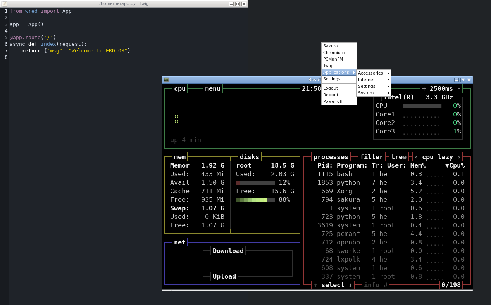

# ErdOS

A minimal Openbox desktop built on **Debian 13 (Trixie), amd64**. Boot a live
session or install the same desktop using Debian’s text installer.

**Version 1 Alpha — `v1.0.0-alpha.1`.** Test in a VM before installing on hardware. Secure Boot
is not supported. Disk selection, partitioning, and the final write confirmation
remain manual.

[Website](https://patx.gitman.io/erdos/) ·
[Downloads](https://github.com/patx/erdos/releases/tag/v1.0.0-alpha.1) ·
[User guide](https://patx.gitman.io/erdos/guide.html) · [Build instructions](docs/building.md)

[ErdOS 1 Alpha 1](https://github.com/patx/erdos/releases/tag/v1.0.0-alpha.1) is available now.
The November 17, 2026 ISO is **1,219,100,672 bytes (1.14 GiB)**. Download the ISO,
checksums, package manifest and source archive from the release page.

Source, offscreen GTK and checksum checks passed. The updated alpha still needs
a fresh boot/install test; see [validation and known limitations](docs/testing.md).



## What you get

- A panel-free Openbox desktop with a single-window **Settings** app, battery
  information, time-zone controls, safe resolution changes, custom keyboard
  shortcuts and a right-click menu editor.
- **Sakura**, **Chromium**, **PCManFM**, and **Twig**. PCManFM includes USB mounting,
  SMB and SFTP support; new graphical apps appear in the Applications submenu.
- Three/four-finger swipe gestures and an on-demand Skippy-XD window overview,
  built with physics disabled. [Swipe layout](https://patx.gitman.io/erdos/guide.html#gestures).
- Dynamic workspaces with one spare, keyboard tiling, exact window-size restoration, screenshot keys,
  volume and brightness bindings, natural scrolling, and two-finger right-click.
- Automatic external-monitor extension to the right, with the laptop primary.
  Workspaces span all screens.
- NetworkManager and PipeWire, plus firmware for common hardware.
- Console login starts Openbox; Logout returns to the login prompt.

There is no display manager, compositor, Snap, GNOME session, Qt desktop stack,
Node.js, or Codex installation. Most package documentation and non-English UI
translations are omitted to reduce installed size. Debian package copyright
notices are retained.

## Try or install

1. Download the ISO and its checksum from [Releases](https://github.com/patx/erdos/releases/tag/v1.0.0-alpha.1).
2. In the download directory, run `sha256sum -c erdos-amd64.iso.sha256`.
3. Attach the ISO to a VM, or write it to a USB device with an image writer.
   Writing an image erases that USB device. Disable Secure Boot.
4. Choose **Try ErdOS** and log in as **user**, password **live**. The live account
   has administrative access. Live-session changes do not persist after reboot.
5. To install, reboot and choose **Install ErdOS (offline)** from the boot menu.

The installer works offline: it copies ErdOS from the USB without network-driver,
Wi-Fi, DHCP or mirror questions. It writes Debian's signed Trixie, updates,
security and firmware repositories automatically. After first boot, connect using
**Settings → Network** and run `sudo apt update`; no mirror editing is needed.
You choose language, keyboard, timezone, account and disk layout. The first
installed account uses its own password for sudo, with direct root password login
disabled.

For an alongside installation, first shrink the other OS’s partition using that
OS’s tools and leave at least **20 GB unallocated**. Choose the largest continuous
free-space option and review the partition plan. Whole-disk installation erases
the selected disk when confirmed. [Read the full installation guide](https://patx.gitman.io/erdos/guide.html#install).

## Useful shortcuts

| Shortcut | Action |
| --- | --- |
| Super + Enter / Ctrl + Alt + T | Sakura |
| Super + B / E / T | Chromium / PCManFM / Twig |
| Super + I | ErdOS Settings |
| Super + Tab / Shift + Super + Tab | Cycle windows forward / backward |
| Super alone / Super + O / Escape | Open / dismiss the window overview |
| Super + Shift + O | Workspace overview |
| Super + Space / Menu | Openbox menu |
| Ctrl + Super + Left / Right | Cycle windows directly (gesture fallback) |
| Shift + Super + 1–9 | Select an existing workspace |
| Super + Left / Right | Tile half-screen |
| Super + Up / Down | Maximize / restore original geometry |
| Print / Alt + Print / Shift + Print | Screenshot desktop / window / area |

Screenshots save silently in `~/Pictures/Screenshots`. Super is usually the
Windows key. [All shortcuts and desktop behavior](https://patx.gitman.io/erdos/guide.html#shortcuts).

## Build from source

Use a **Debian 13 amd64** host with internet access and at least 20 GB free per
build. Build tools stay on the host, outside the resulting image.

```sh
sudo apt update
sudo apt install live-build debootstrap xorriso squashfs-tools wget cpio file apt-utils ca-certificates git python3 gcc libc6-dev pkg-config libx11-dev libxrandr-dev meson ninja-build libxcomposite-dev libxdamage-dev libxext-dev libxfixes-dev libxft-dev libxrender-dev libxi-dev libxinerama-dev libgif-dev libjpeg-dev libpng-dev
sudo ./build.sh
```

Each run snapshots the configuration into a fresh `work/build-XXXXXXXX/` directory.
Successful images and checksum sidecars appear under `dist/`. The script never
writes a USB device or installs onto a host disk. Run `./build.sh --prepare` to
stage the files without root, compiling helpers, or generating an ISO.

See [building and customization](docs/building.md), [validation](docs/testing.md),
and [release preparation and Pages setup](docs/releasing.md). Existing ErdOS
installations can use the optional [desktop updater](docs/building.md#update-an-existing-erdos-installation).

## Project layout

| Path | Purpose |
| --- | --- |
| `config/` | Package lists, desktop defaults, boot templates and installer preseed |
| `helpers/` | Small native X11/RandR tiling and monitor-layout helpers |
| `vendor/twig/` | Pinned Twig runtime, icons, upstream revision and license |
| `scripts/` | Staging, helper compilation, validation and release tools |
| `docs/` | Static Pages website, user guide and maintainer documentation |
| `branding/` | Original ErdOS logo |
| `LICENSES/` | Third-party license texts and notices |

Build directories, ISO files, downloads, generated helper binaries and local VM
test artifacts are ignored. The source repository does not contain disk images,
private test credentials, or build logs.

## Status and contributing

The November 16 base image passed UEFI live boot and a fresh UEFI installation
with two virtual disks. The disk picker and default-No write confirmation stayed
interactive; the unselected disk remained untouched. Installed-system checks
passed sudo authentication, online APT repositories, retained scrot, and full,
window and region screenshots. Physical touchpads, backlights, docks, Windows/macOS
dual boot, encrypted storage and unusual hardware need further testing.

Read [CONTRIBUTING.md](CONTRIBUTING.md) before sending changes, and use
[GitHub Issues](https://github.com/patx/erdos/issues) for reproducible bugs.
Security-reporting guidance is in [SECURITY.md](SECURITY.md).

## Licenses

ErdOS’s original code and documentation are [MIT licensed](LICENSE).
Debian-derived bootloader templates retain GPL-3.0-or-later
terms, Skippy-XD retains GPL-2.0-or-later, Twig retains its own MIT notice, and
software inside an ISO retains its respective upstream
licenses. See [THIRD_PARTY.md](THIRD_PARTY.md). ErdOS is an independent project,
not an official Debian image.

## Settings

Press **Super + I** or select **Settings** in the desktop menu for a single-window
Python/GTK app covering Appearance, Touchpad, Keyboard, Menu, Gestures, Displays,
Sound, Network, Bluetooth, Power and Date & Time. Add custom keyboard commands
and edit the right-click menu directly in Settings. It reuses Python/GTK and exits when closed;
xrandr supplies resolution changes.
See [Settings controls and limitations](docs/settings.md).

Automatic time synchronization uses `systemd-timesyncd`. Live and installed
sessions share signed Debian APT sources, with no live-media update source.
Settings includes Bluetooth pairing and device controls using BlueZ, with
PipeWire Bluetooth audio support and no separate tray app.
