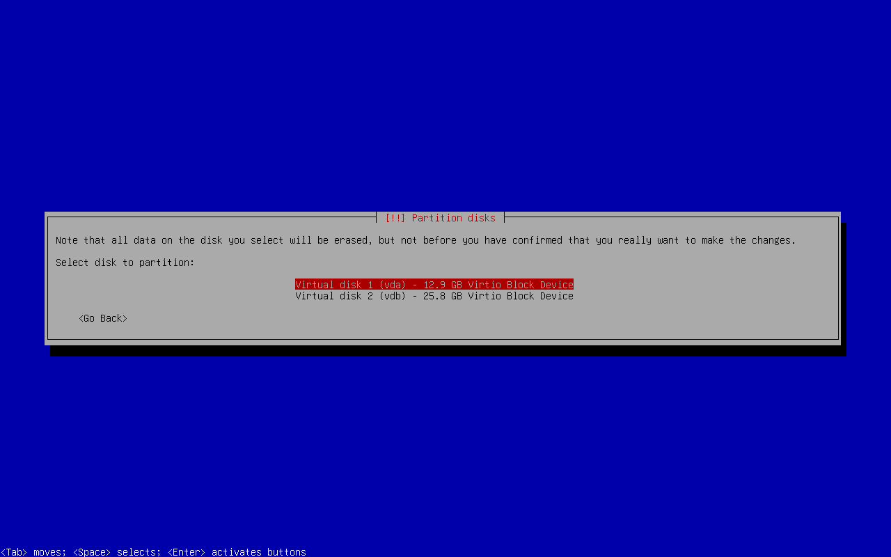
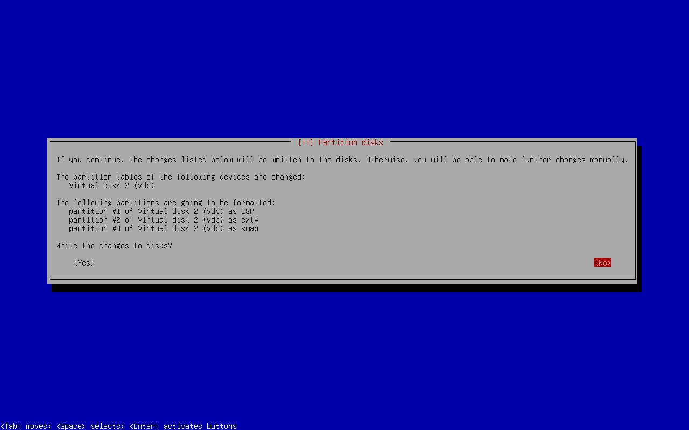

# Validation and limitations

## Public release — 1.0.0-alpha.1

[ErdOS 1 Alpha 1](https://github.com/patx/erdos/releases/tag/v1.0.0-alpha.1) is the public November 17, 2026 release.
The ISO is **1,219,100,672 bytes (1.14 GiB)** with SHA-256:

```text
4a125062e3e97d40225f4dc18c8e61d2be1a1cf45ec012e5222cd130ac9a9ec3
```

Source/configuration, offscreen GTK, filesystem metadata and internal/release
checksum checks passed. This update adds menu editing, custom keyboard shortcuts
and reversed four-finger workspace swipes to the November 16 package base.
A fresh boot/install test of this exact alpha remains pending. The disk and RAM
measurements below belong to the November 16 base image.

The following dated sections are historical validation records. Alpha 2 candidate
results are recorded under [Alpha 2 validation](#alpha-2-validation).

## November 16 base image — time sync and Bluetooth

Built November 16, 2026, **1,219,952,640 bytes (1.14 GiB)**.

```text
0e558028b33519f8d7d36ed131b84f3ec113b5d9dba344c6660ac2e4d657241a
```

- Built the ISO and verified its embedded configuration and required-package
  retention, including BlueZ, time synchronization, Bluetooth audio and APT keys.
- Booted the final ISO through UEFI. Both new Settings sections load; the VM
  reports the absence of a running Bluetooth service without blocking the app.
  Date & Time displays synchronization state. Closing Settings leaves no process.
- Deliberately moved the live VM clock five hours backward, then verified
  systemd-timesyncd corrected it using an isolated NTP test peer. A real signed
  HTTPS APT update then succeeded against Debian main, updates and security.
  Restored the default NTP configuration after the test. No signature/date checks
  were disabled and no live-media repository remained active.
- Exercised Bluetooth with real GTK widgets and an isolated BlueZ D-Bus simulator:
  no-adapter handling, adapter hotplug/power, discovery, pair/connect, trust,
  disconnect, rejected pairing, passkey entry, forget confirmation and cleanup.
  Scanning stopped when leaving the page and after its 30-second limit.
- Added package names versus the previous ISO: bluez, libdw1t64 and
  systemd-timesyncd. Their declared Installed-Size totals 5,815 KiB. PipeWire's
  Bluetooth audio library was already present. This is package payload, not a
  fresh measurement of filesystem usage or idle RAM.
- Completed a fresh UEFI installation with no network adapter. Disk selection
  and final write confirmation remained manual. Booted without the ISO and
  confirmed correct signed sources, no online indexes or installer network
  fetches, first-account sudo, enabled/active time synchronization, retained
  Bluetooth/audio packages and an untouched spare virtual disk. Attached a
  network adapter afterward: a real signed APT update succeeded without source
  edits, and automatic time synchronization reported enabled and synchronized.
- Refreshed the Settings screenshot from the finished ISO.

Physical Bluetooth pairing/audio and laptop sleep/resume still need hardware
checks. The simulated Bluetooth test does not prove radio, firmware or codec
compatibility. The current image’s installed disk/RAM measurements are recorded below.
Nothing was committed or published.

## Installed footprint — November 16 base image

A fresh offline UEFI install of the November 16 ISO (`0e558028…657241a`) measured
**1.86 GiB used on root + EFI** (1,994,551,296 bytes), excluding the separate
**1.25 GiB swap partition**, which had zero bytes in use. Measured November 16,
2026. No APT indexes were downloaded and no packages were added, removed or
upgraded after installation.

The default panel-free desktop used a median **379.8 MiB RAM** (398,258,176 bytes)
across five samples ten seconds apart after a two-minute settling period.
RAM is `MemTotal - MemAvailable`; Openbox, the file-manager daemon, gesture/workspace
listener, audio, NetworkManager and time synchronization ran normally. No application
windows were open. The serial shell and Python sampler are included.

The VM had 2 GiB allocated RAM, two virtual CPUs, a 24 GiB disk and a
1280 × 800 display, and booted without the ISO. No network or Bluetooth adapter
was exposed. Bluetooth is enabled by default, but its hardware-conditional
service was inactive. These are measured VM results, not minimum system
requirements or promises for all hardware. Exact readings and the full tested
ISO checksum are in [footprint.json](https://github.com/patx/erdos/blob/v1.0.0-alpha.1/docs/footprint.json); the
[user guide](https://github.com/patx/erdos/blob/v1.0.0-alpha.1/docs/guide.html#footprint) explains the method. The homepage displays
1.86 GiB and rounds idle RAM to 380 MiB.

The previous pre-settings image (`7aa3a025…a318467`) measured 1,952,169,984 bytes
on disk and 408,543,232 bytes idle RAM under the earlier VM test. Those older
figures are no longer used on the homepage.

## Previous panel-free desktop image

Built November 16, 2026, **1,218,756,608 bytes (1.14 GiB)**.

```text
64a5556446319fa396a8fa1965c924f5b837ec6e4149a107aa26d12f4175958c
```

- Built the ISO and verified its desktop files, installer configuration, required
  packages and patched, physics-disabled Skippy against source.
- Booted the final ISO through UEFI into Openbox. Verified Super+Space opens the
  root menu, Super alone opens the window overview, and Super+Shift+O opens the
  workspace overview. Skippy exits after dismissal. Tint2 is absent.
- Switching to workspace 2 with Shift+Super+2 created a third, spare workspace.
  Isolated Xorg checks also covered occupied/minimized workspace retention,
  trailing-empty removal, fixed counts, shortcut saves and Super-chord suppression.
- Exercised all nine Settings sections in GTK. In the final VM, tested resolution
  change and Revert, loaded timezones, changed to Europe/London and restored
  America/New_York through the Settings controls. No-battery reporting worked.
- Separate real RandR tests covered Keep/persistence, 15-second automatic rollback,
  client disconnection rollback, invalid modes, and two-output adjacency and restore.
- The workspace/Super listener reuses the gesture process and is event-driven;
  its CPU counters stayed unchanged during a three-second idle check.
- Updated the desktop and Settings screenshots from this ISO.

Physical battery readings, monitor hot-plugging, and touchpad gestures still need
hardware testing with this image. The unchanged installer was verified against
source; a full disk installation was not repeated for this older image.
Nothing was committed or published.

## Previous Settings image

Built November 16, 2026, **1,248,460,800 bytes (1.16 GiB)**.

```text
01097fb645c5ae9f3ef632d14d5fc7598ad7b2e05403a3b3d3d5923608d8f681
```

- Verified the actual ISO's desktop files against source, embedded installer
  configuration, required-package retention and physics-disabled Skippy provenance.
- Compared package manifests: all **595 package names are unchanged**, with no
  added or removed runtime packages for Settings. The app, Python backend and
  stripped touchpad helper total **40,165 bytes** of file contents, plus small
  launcher/menu entries and filesystem metadata.
- Booted the final ISO through UEFI into Openbox and opened Settings with Super+I.
  Repeated activation reused one window. The VM's Alt+F4 closed it without leaving
  a Settings process running.
- Using a virtual libinput touchpad inside that VM, changed and read back natural
  scrolling, tapping, click method and acceleration speed. The login restore
  command reapplied the saved preferences after deliberately changing device state.
- Disabled and restored a four-finger swipe through Settings' backend; actual
  swipes followed the new binding without restarting the gesture listener.
- Confirmed display policy stopped and restored exactly one existing display watcher.
- In an isolated Debian GTK desktop, exercised all seven sections, saved clock
  changes and shortcuts, rejected duplicate/unknown shortcuts without overwriting
  the config, and checked audio commands, network refresh, empty-network selection
  and missing-touchpad behavior. The unknown-key regression failed before its fix
  and passed afterward. Without an audio server, window construction took 0.10 s
  and keyboard controls remained usable while service discovery ran separately.

Physical Wi-Fi authentication, laptop backlight permissions and multi-monitor
hot-plugging through Settings still need hardware testing. This build has not
repeated the full disk-installation tests below; its installer policy is unchanged
and verified against source. This older Settings build was not measured for
installed disk/RAM usage. Nothing was committed or published.

## Previous offline-installer image

Built November 16, 2026, **1,248,460,800 bytes (1.16 GiB)**.

```text
7aa3a02503117e1326d0dcf5bfc19d3c72c07dcd9c0c1625c4645a3caa318467
```

This section records an older development image, not the published alpha.
The source CI checks source/staging integrity and compilation. It does not build
an ISO or replace VM/physical-hardware testing.

## Checks completed for the previous offline-installer ISO

- Booted the unmodified ISO through UEFI, logged into its public live account,
  and reached Openbox automatically.
- Compared all 30 desktop customization files against the actual squashfs,
  including the direct gesture I/O module, and verified Skippy-XD's binary hash,
  source revision and disabled-physics build record.
- Extracted and verified the real installer preseed and offline APT finish hook;
  supplied language, keyboard, timezone and disposable account answers only in a private VM test initrd.
- Installed through UEFI and BIOS with two empty virtual disks and **no network
  adapter**. Neither run asked for a network driver or mirror. Both paused for
  partitioning method, disk choice, layout review and final write approval, which
  defaulted to No. The unselected disk remained completely unwritten.
- Completed installation offline, then booted both installed systems with the
  ISO removed and networking still absent. Confirmed all three signed Debian
  suites were configured, CD/duplicate sources were absent, and installer logs
  contained no online index fetches or DNS retries.
- Attached a network adapter to the UEFI VM only after those checks, then updated APT against
  Debian CDN, security and updates repositories without editing any sources.
- Confirmed that the first account authenticated sudo with its own password,
  root password login was locked, and scrot remained installed.
- Triggered actual X11 Print, Alt+Print and Shift+Print bindings; checked valid
  full-desktop, window and region PNGs with private file permissions.
- Triggered actual X11 volume/mute bindings against the VM’s PipeWire devices;
  checked brightness tools, udev-rule validity and video-group membership.
- Exercised all six swipe bindings using a virtual multitouch touchpad through
  uinput, libinput, the real listener and X11 in the fresh UEFI installation. Checked
  repeated swipe-up, safe dismissal, cycling three distinct windows and wrapping both workspaces.
- Confirmed normal-user touchpad access without readable keyboard event nodes
  or input-group membership; no idle Skippy process, compositor or physics library.
- A forced controller crash confirmed termination of the process owning the input
  descriptor; there is no separate raw-input reader to leave behind.

Using the same direct controller on the prior ISO, VM tests checked the actual
Super+O/Escape bindings and logout to a fresh login prompt. They also confirmed that
it closes the touchpad descriptor on an inactive virtual terminal and reopens it
on return, without acting on swipes made while inactive. An overview containing
minimized and off-workspace windows was visually checked; such windows can use
icon/title placeholders.

On the preceding image with the same gesture controller, a controlled
virtual-touchpad test showed median workspace response falling from
1,393.7 ms on the previous ISO to 299.8 ms on its live image (five samples each).
That fresh installation measured 300.2 ms in the same test; this offline-installer
image measured 304.8 ms after installation. Timing starts at contact and includes
a deliberate contact-settling period,
movement and a 600 ms hold before release. The old reader waited for release;
the new reader acts during motion. The test also checked one action per long
swipe and ignored small accidental movements. These are comparative VM results,
not latency guarantees for physical laptops. The controller adds no runtime
packages and omits libinput-tools and python3-libevdev. Physics, animations and
an idle Skippy daemon remain disabled.





Earlier revisions also exercised BIOS live boot, whole-disk installation and
installation into free space alongside another Linux system; automatic display
layout with a private multi-output Xorg server; tiling/restore/cycling/workspaces;
USB mounting; SMB/SFTP file access; desktop-entry installation/removal; Twig edits;
and logout back to a fresh login prompt. Those earlier tests should not be
misread as a fresh test of every feature on the latest ISO.

## Required before a new public image

Use disposable VM disks. Verify the actual final ISO, not only source files or
an intermediate chroot. Test live boot and a fresh installation after any package,
account-policy, installer or bootloader change. Keep language/account test answers
in a separate VM-only initrd; never copy automated disk answers into production.

Confirm that disk choice and the final write prompt remain interactive, boot the
result without the ISO, run `sudo -v` as the first normal account, update APT, and
test all three screenshot keys. Check package retention after installation, not
only in the live session. Confirm the checksum after copying the final artifact.
Record the ISO hash, boot mode, VM configuration, steps, results and limitations
in the release notes. Local test fixtures and full logs stay in ignored
`validation/`; publish only useful, redacted evidence.

## Still requires testing

Physical touchpad gestures, brightness/backlight hardware, docking stations,
multi-GPU/mixed-DPI layouts, vendor-specific keyboard keys, Windows/macOS dual
boot, encrypted installations and unusual storage/controllers are not covered by
the latest VM test. Secure Boot is unsupported. Firmware selection is deliberately
limited to common hardware; missing device support is not automatically resolved
by switching installers. Host shortcuts or keyboard firmware can intercept keys
before a VM receives them.

## November 17 menu and shortcut update

- Checked add/edit/delete/reorder of root-menu entries, XML escaping, retention
  of the automatic Applications submenu and Logout action, backup creation,
  invalid-entry rejection and protection against overwriting external edits.
- Exercised the Menu and custom Keyboard controls in an offscreen GTK window,
  including adding, editing and applying entries to temporary user files.
  Openbox's reconfigure command was stubbed for these host-side checks.
- This image reuses the November 16 package base, replacing the Settings UI,
  settings backend and gesture defaults, then recompressing the filesystem and
  regenerating the hybrid ISO. No packages were added. The standard full
  Debian live-build script remains available for clean builds.
- Disk/RAM figures in the guide are the recorded November 16 VM measurements,
  not a new measurement of this update. Physical swipe behavior needs testing
  on the target laptop.

The rebuilt ISO passed the source/configuration and installer-policy verifier,
required-package retention checks, internal SHA-256 checksums, and release-asset
checksums. Its hybrid BIOS/UEFI boot records are present. Filesystem ownership,
modes, device nodes and symlinks were compared with the base image; only the
three intended source files changed. This update has not yet had a fresh VM boot
or physical-laptop test.

## November 19 image-background development build

This local update adds image backgrounds to Appearance using hsetroot and Imlib2
already present in Alpha 1. No packages or services were added. The new build is
separate from the public Alpha 1 ISO; the published download and recorded base
footprint measurements are unchanged.

Checks used the ISO's own Debian Python/GTK, hsetroot and Imlib2 runtime inside
an isolated Xvfb display, without changing the host desktop:

- Rendered Fill, Fit, Center and Tile; checked that Fit uses the selected solid
  color around the image.
- Verified private-copy contents and permissions, persistence after removing the
  original, rejection of unreadable selections, and missing/corrupt-image fallback.
- Applied changes through the GTK Appearance controls, reapplied after deleting
  the original, then removed the image and restored the saved solid color.
- Verified that the existing X11 gesture listener reapplies the image after a
  real RandR screen-change event. No wallpaper polling loop or daemon was added.

The image is rebuilt from Alpha 1's package base, replacing only the Settings UI,
settings backend and X11 listener module. A fresh boot/install test and physical
multi-monitor/hotplug testing of this image remain pending.

The November 19 rebuilt image passed source/configuration and installer-policy
verification, hsetroot/Imlib2 retention checks, all internal SHA-256 checksums,
and comparison of the unchanged Debian package manifest. Filesystem metadata
and hybrid BIOS/UEFI boot records were checked. These checks do not replace the
pending fresh boot/install and physical-monitor tests.

## Alpha 2 validation

Local candidate **1.0.0-alpha.2**, built November 19, 2026. Not published.
ISO: `erdos-1.0.0-alpha.2-amd64.iso`, **1,219,100,672 bytes (1.14 GiB)**.

```text
866ff42994830c6bba9aadd3f8ce15d16ca6ac4e72e8151f5018cdd9d97e3491
```

This candidate includes image backgrounds, a small flat dark Openbox theme,
Adwaita dark defaults, dismissible Settings feedback and Retry controls, and
automatic installed boot with a cleared tty1 login prompt. Standard Skippy
remains unchanged, with physics and animations disabled. Its rejected dock/status
experiment is absent. No runtime packages were added; its Debian package manifest
is identical to the wallpaper base and Alpha 1.

Fresh-install checks used a disposable UEFI/KVM VM, two virtual CPUs, 2 GiB RAM
and one empty 24 GiB virtual disk. No physical disk was exposed. Installation
was entirely offline, with no network adapter. A private test initrd appended
VM-only account and partition answers to the verified production preseed; the
distributed ISO keeps destination disk, partitioning and erase confirmation
manual. The installer completed and the VM booted from its installed disk with
the ISO removed.

Passed on that installed system:

- Automatic boot without selecting an entry; generated GRUB configuration uses
  a one-second hidden timeout. A clean `erdos login:` prompt was visible without
  pressing Enter, on first boot, after reboot and after desktop logout.
- Normal account authentication and sudo using its own password; the created
  account belongs to the sudo group.
- All default app executables, including scrot, hsetroot and xrandr, retained.
  Terminal/editor keyboard launch smoke checks and actual screenshot creation.
  The standard window overview and dark right-click menu were inspected.
- All eleven Settings sections loaded with the installed services. Absent
  battery/Bluetooth hardware showed ordinary no-device states. GTK dark defaults
  and the installed Openbox theme were checked visually.
- Wallpaper Apply through the real GTK controls, successful feedback and its
  dismissal; private copy survived deletion of the original image, reboot and
  login. Remove image + Apply removed the private copy and restored solid color.
- No failed systemd units. Automatic time synchronization enabled. After adding
  a virtual network adapter, clock synchronization completed and `apt-get update`
  fetched signed Trixie, updates and security indexes successfully (exit 0),
  without editing sources. No live-media/CD-ROM source remained enabled.

An isolated Debian GTK/Openbox check also exercised actual menu Apply and
reconfiguration, invalid-shortcut error feedback, Retry after a failed system-bus
read, and feedback dismissal. All 670 internal ISO SHA-256 entries passed. The
source/configuration verifier passed, including required package retention and
Skippy's disabled-physics build provenance. BIOS/UEFI hybrid boot records remain
present. Filesystem listings verified that unmodified metadata, ownership,
modes, devices and symlinks were preserved.

This is a fresh UEFI whole-disk installation test, not a new BIOS, alongside-OS
or physical-laptop test. Touchpad gestures, Bluetooth hardware and monitor
hotplug still require hardware validation. The published website's footprint
figures remain the documented November 16 measurements; no new idle-RAM claim
is made for Alpha 2. Public Alpha 1 ISO assets and links are unchanged.

## Current source — default programs, Network feedback and regular Firefox

These changes are newer than the Alpha 2 ISO recorded above. The ISO and USB
have not been rebuilt with them. No commit or publication was made.

Default-program checks used a private Debian GTK profile, real GIO desktop
associations and executable desktop-entry fixtures. Applying all four choices
through the actual Settings controls changed the expected associations. Every
shipped root-menu and app-shortcut command launched its selected program.
Quoted Exec arguments, the home-folder argument, an external browser-default
change, removal of the selected terminal and rejection of stale selections
were exercised. The removed-terminal regression failed before the fallback fix
and passed afterward. No host default-program configuration was changed.

Network feedback checks used actual GTK controls, nmcli protocol fixtures and
NetworkManager PropertiesChanged messages on a private D-Bus. They covered
progress, wrong-password failure, connected/disconnected states, radio off,
unavailable hardware, no adapter, no visible networks, captive-portal versus
Wi-Fi connection state, clearing stale confirmations, device disconnect, and
listener cleanup. Passwords were absent from command-line arguments. Wireless
transcripts simulate hardware; this is not a physical Wi-Fi authentication test.

The new source was also run inside the previously installed disposable UEFI VM
against its real Debian services. All twelve Settings sections loaded. Selecting
regular Mozilla Firefox through the GUI set the web associations, and the shared
browser launcher opened its visible Firefox window. Real wired disconnect and
reconnect operations refreshed the Network tab through NetworkManager events;
no-Wi-Fi-adapter state and disabled controls remained correct.

Mozilla's regular `firefox` DEB installed from its signed APT repository, with
repository origin and `firefox.desktop` verified. The tested package was
`160.0.1~build1`, reporting Mozilla Firefox 160.0.1, not ESR. With the VM's
network disconnected, the updated repository-setup helper restored the scoped
Mozilla and Debian sources successfully. After reconnection, a signed APT
update completed without editing sources. The checked-in Mozilla public key
was verified against the fingerprint in Mozilla's official instructions.

A separate clean Debian minbase bootstrap included CA certificates before the
first HTTPS request, accepted the live-build Mozilla source/key/pinning and
resolved regular Firefox without Snap, GNOME, Qt, Node.js, ESR or Chromium.

Source syntax, local links, installer policy, whitespace checks and customization
staging passed. Full image generation and a fresh install of these newer source
changes remain pending; no new disk/RAM measurement is claimed. Public Alpha 1
assets and the already-flashed Alpha 2 image remain unchanged.
